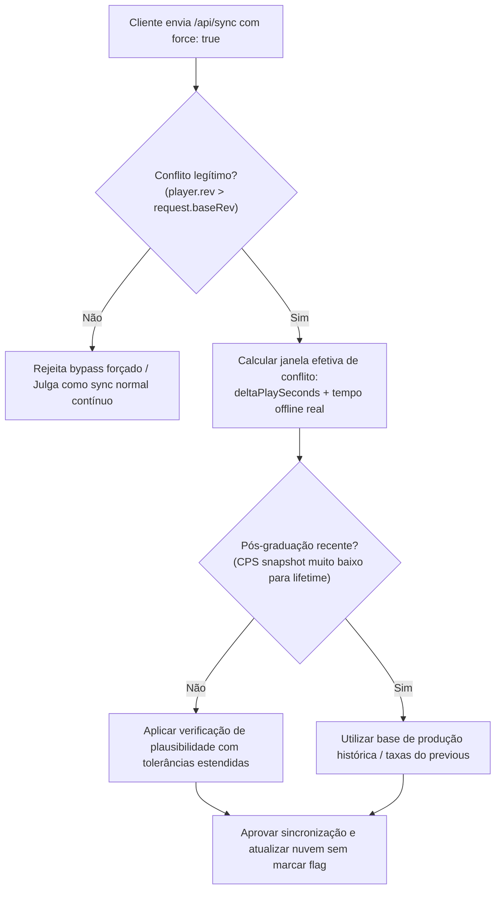
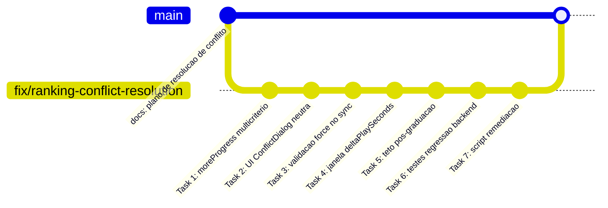

# Plano de Correção Definitivo: Resolução de Conflitos de Progresso e Eliminação de Falsos Positivos no Ranking

**Status:** Aprovado para Implementação  
**Data:** 2026-10-20  
**Contexto:** Investigação e correção de incidente em que jogadores legítimos são removidos do ranking ao sincronizar em cenários multi-dispositivo (ex.: alternando entre celular e PC), após interação com a tela de conflito de progresso.

---

## 1. Diagnóstico do Incidente e Análise de Causa Raiz

### 1.1 Reconstrução do Incidente do Jogador
Ao abrir o jogo no celular após ter jogado anteriormente:
1. O jogo detectou divergência entre a revisão local (`baseRev`) e a revisão da nuvem (`player.rev`), disparando a tela de conflito ([ConflictDialog.tsx](file:///home/seyffert/Downloads/adsclicker/src/ui/game/cloud/ConflictDialog.tsx)).
2. **Por que a interface recomendou o save com menor tempo de jogo:**
   - Ao iniciar, o jogo processa ganhos offline via [`applyOffline`](file:///home/seyffert/Downloads/adsclicker/src/game/engine/offline.ts#L20-L50). Isso aumenta `lifetimeCoins`, mas **não incrementa `counters.playSeconds`** (tempo de jogo ativo).
   - A função [`moreProgress`](file:///home/seyffert/Downloads/adsclicker/src/game/cloud/summary.ts#L30-L38) compara **estritamente `lifetimeCoins`**. Como o save local recebeu moedas offline, suas moedas superaram as da nuvem, fazendo a UI rotular "Este aparelho" como recomendado, ignorando que o save da nuvem possuía muito mais horas de jogo ativo, graduações e diplomas.
3. **Por que a remoção do ranking ocorreu:**
   - Se o usuário tivesse clicado em "Usar a nuvem", o cliente executaria `adoptCloud` ([createCloud.ts:206](file:///home/seyffert/Downloads/adsclicker/src/game/cloud/createCloud.ts#L206)) e `importSave` ([createStore.ts:341](file:///home/seyffert/Downloads/adsclicker/src/game/store/createStore.ts#L341)), que zera o tempo ausente (`lastTickAt = now`) e sincroniza a revisão da nuvem sem ganho de moedas. **"Usar a nuvem" é matematicamente incapaz de marcar o jogador como trapaceiro.**
   - O jogador **necessariamente clicou em "Manter este aparelho"** ([keepLocalSave](file:///home/seyffert/Downloads/adsclicker/src/game/cloud/createCloud.ts#L511)), enviando `force: true` para `/api/sync`.
4. **O gatilho da marcação no Backend (`sync.ts`):**
   - No backend ([sync.ts:133-135](file:///home/seyffert/Downloads/adsclicker/src/server/players/sync.ts#L133-L135)):
     ```typescript
     const stored = player.save !== null ? deserializeState(player.save, content, now) : null;
     const previous = stored && !(request.force && isRollback(stored, parsed)) ? stored : null;
     const elapsedMs = now - player.lastSeenAt.getTime();
     const coinVerdict = judgeSave({ previous, next: parsed, elapsedMs, forced: request.force });
     ```
   - Como o save do celular tinha mais moedas, `isRollback(stored, parsed)` resultou em `false`.
   - Consequentemente, `previous` foi mantido como `stored` (o save do outro aparelho gravado na nuvem).
   - O servidor calculou `elapsedMs` baseado em `now - player.lastSeenAt` (que registrava o último sync feito pelo outro aparelho, muitas vezes ocorrido há apenas minutos ou segundos).
   - O anticheat comparou o ganho massivo de moedas obtido no celular contra uma janela de poucos segundos:
     $$\text{gain} = \text{parsed.lifetimeCoins} - \text{stored.lifetimeCoins} > \text{ceiling}(\text{elapsedMs})$$
   - Resultado: O jogador foi reprovado por `more coins than the state can produce in the time elapsed`, marcado com `flagged = true` e excluído silenciosamente dos placares.

---

### 1.2 Causas Técnicas Fundamentais

1. **Heurística Unidimensional no Frontend (`summary.ts`):**
   `moreProgress` olha apenas para moedas acumuladas. Moedas em jogos idle são altamente voláteis e resetam em prestígio, enquanto Diplomas, Graduações, Conquistas e Tempo de Jogo são marcos estritamente cumulativos e representam o verdadeiro esforço do jogador.
2. **Premissa Inválida de Linha do Tempo no Backend (`sync.ts`):**
   O anticheat assume que dois saves de dispositivos distintos compartilham a mesma linha do tempo linear de `lastSeenAt`. Quando há conflito legítimo entre aparelhos, o delta de moedas foi produzido durante o tempo em que o aparelho esteve desconectado, e não no intervalo de ping do servidor.
3. **Vulnerabilidade de Bypass & Paradoxo da Graduação (`plausibility.ts`):**
   - Não se pode simplesmente forçar `previous = null` em qualquer requisição com `force: true`: isso permitiria que clientes maliciosos forjassem `force: true` em syncs normais para ignorar o anticheat de tempo.
   - Além disso, quando `previous === null`, o teto de moedas é avaliado usando `next.cps`. Se o jogador acabou de graduar ([prestige.ts](file:///home/seyffert/Downloads/adsclicker/src/game/engine/prestige.ts)), o CPS do momento é o inicial (quase zero), gerando um teto minúsculo que reprova saves legítimos com bilhões de moedas no histórico de turmas passadas.

---

## 2. Solução Arquitetural Completa

O objetivo é resolver a falha de forma estanque: **impedir falsos positivos em conflitos legítimos sem enfraquecer o anticheat contra injeções forjadas**.



---

### Fase 1: Backend — Validação Segura de Sobrescritas Forçadas

#### 1.1 Validação de Legitimidade do Conflito no Servidor
* **Arquivo:** [`src/server/players/sync.ts`](file:///home/seyffert/Downloads/adsclicker/src/server/players/sync.ts)
* **Regra:** O parâmetro `request.force = true` só é aceito como resolução de conflito se a conta estiver de fato em estado de conflito (`player.rev > request.baseRev`).
* Se um cliente enviar `force: true` sem haver divergência de revisão (`player.rev === request.baseRev`), o servidor ignora a flag `force`, impedindo que scripts usem a flag como brecha contínua para escapar da verificação de tempo.

#### 1.2 Cálculo de Janela Temporal para Sobrescrita Forçada
* **Arquivo:** [`src/server/players/sync.ts`](file:///home/seyffert/Downloads/adsclicker/src/server/players/sync.ts) e [`src/server/players/plausibility.ts`](file:///home/seyffert/Downloads/adsclicker/src/server/players/plausibility.ts)
* **Ação:** Em um conflito legítimo com avanço de moedas (`request.force === true` e `player.rev > request.baseRev`):
  1. A janela temporal de produção não pode ser `now - player.lastSeenAt`.
  2. A janela temporal efetiva deve ser calculada a partir do tempo de jogo do próprio save que está sendo enviado:
     $$\Delta t_{\text{play}} = \max(0, \text{next.playSeconds} - \text{stored.playSeconds})$$
     somado ao tempo decorrido desde a última vez que aquele aparelho esteve ativo.
  3. Para conferência de limite superior, $\Delta t$ é limitado pelo tempo decorrido real desde a criação da conta ou último reset de época (`now - player.createdAt.getTime()`).
  4. Mantém-se o `stored` como referência para comparar consistência de conquistas e marcos permanentes, mas sem penalizar o ganho de moedas pela janela de ping da nuvem.

#### 1.3 Resiliência no Teto de Produção Pós-Graduação
* **Arquivo:** [`src/server/players/plausibility.ts`](file:///home/seyffert/Downloads/adsclicker/src/server/players/plausibility.ts)
* **Ação:**
  - Quando um save é avaliado sem baseline temporal direto (ou com reset de turma recente):
  - Se `next.counters.graduations > 0`, a taxa de produção histórica não pode ser limitada ao CPS mínimo da turma recém-iniciada.
  - O cálculo do teto deve considerar o multiplicador global de diplomas (`1 + diplomas * diplomaBonus`) e o bônus de prestígio que o jogador já desbloqueou permanentemente no save.
  - Se `previous` estiver disponível (mesmo em sobrescrita forçada), utilizar `best(cps)` entre o snapshot atual e o `stored`, garantindo que o potencial econômico do jogador antes de graduar seja respeitado.

---

### Fase 2: Frontend — Heurística Precisa e UX sem Coerção

#### 2.1 Reformulação da Comparação de Progresso (`moreProgress`)
* **Arquivo:** [`src/game/cloud/summary.ts`](file:///home/seyffert/Downloads/adsclicker/src/game/cloud/summary.ts)
* **Ação:** Substituir a comparação de moedas por um algoritmo de dominância multicritério:
  1. **Critérios Irreversíveis Primários:** Diplomas obtidos (`diplomasEarned`), Conquistas (`achievements`) e Turmas graduadas.
  2. **Critério de Investimento:** Tempo de jogo ativo (`playSeconds`).
  3. **Critério Secundário de Desempate:** Moedas acumuladas (`lifetimeCoins`).
* **Estados de Retorno:**
  - `'local'`: O save local é superior ou igual em todos os critérios e estritamente superior em pelo menos um.
  - `'cloud'`: O save da nuvem é superior ou igual em todos os critérios e estritamente superior em pelo menos um.
  - `'tie'`: Ambos os saves possuem exatamente os mesmos marcos e tempo.
  - `'mixed'`: Os saves divergiram de forma assimétrica (ex.: celular tem mais moedas devido a offline, mas PC tem mais diplomas e tempo de jogo).

#### 2.2 Redesenho do Diálogo de Conflito (`ConflictDialog.tsx`)
* **Arquivo:** [`src/ui/game/cloud/ConflictDialog.tsx`](file:///home/seyffert/Downloads/adsclicker/src/ui/game/cloud/ConflictDialog.tsx)
* **Melhorias de Interface:**
  1. **Tratamento do estado `'mixed'`:** Quando os dados divergirem de forma mista, o diálogo **não deve recomendar nenhuma das opções**. Deve exibir um aviso em destaque:
     > *"Os aparelhos têm progressos diferentes. Compare o tempo de jogo e os diplomas com atenção antes de escolher."*
  2. **Neutralidade Visual:** No estado `'mixed'`, nenhum dos botões recebe estilo primário de destaque, evitando cliques acidentais induzidos pela cor.
  3. **Exibição Transparente:**
     - Data real da última gravação local (registrada no momento do carregamento da página no cliente, em vez do texto genérico "agora").
     - Data do save da nuvem formatada relativa e absoluta.
     - Tempo total jogado (ex.: "14h 32min").
     - Total de diplomas e graduações em destaque.
  4. **Confirmação de Perda:** Se o jogador clicar para escolher um save que possui menos tempo de jogo ou menos diplomas que o outro, exigir uma etapa de confirmação rápida:
     > *"Atenção: o save selecionado tem menos horas de jogo que o outro. Deseja realmente substituir?"*

---

### Fase 3: Validação de Qualidade e Testes de Regressão

#### 3.1 Testes Unitários e de Integração
* **Arquivo:** `src/server/players/sync.test.ts` e `src/server/players/plausibility.test.ts`
* **Cenários Mandatórios:**
  1. **Conflito legítimo com avanço multi-dispositivo:** `syncPlayer` com `player.rev > request.baseRev`, `force: true` e moedas muito superiores à nuvem $\rightarrow$ Deve aprovar com `status: 'ok'` e `flagged: false`.
  2. **Tentativa de bypass fraudulento:** `syncPlayer` com `player.rev === request.baseRev`, `force: true` e ganho impossível em `elapsedMs` $\rightarrow$ Deve reprovar e marcar o jogador como suspeito (`flagged: true`).
  3. **Sobrescrita pós-graduação:** Save com 5 graduações e moedas de início de turma sincronizado via `force: true` $\rightarrow$ Deve aprovar sem erros de teto zerado.
  4. **Heurística mista no cliente:** Save A com 10h jogadas e 5 diplomas vs Save B com 2h jogadas e $10^{15}$ moedas offline $\rightarrow$ Deve retornar `'mixed'` e não induzir escolha errada.

---

## 3. Guia Operacional: Identificação e Restauração de Contas Afetadas

Esta seção detalha o procedimento prático no banco de dados para auditar jogadores prejudicados e restaurá-los com segurança ao ranking.

### 3.1 Como Confirmar no Banco de Dados que Houve Remoção Injusta

As punições do anticheat são registradas na tabela `server_logs` sob o tipo `sync_suspect` e refletidas na tabela `players` nas colunas `flagged` e `flag_reason`.

#### Passo 1: Localizar jogadores marcados em requisições forçadas (`force = true`)
Execute a seguinte consulta SQL no Postgres:

```sql
SELECT 
    l.at AS incident_at,
    p.id AS player_id,
    p.nickname,
    p.flagged,
    p.flag_reason,
    p.last_seen_at,
    p.play_seconds,
    p.diplomas_earned,
    p.lifetime_coins_text,
    l.detail->>'reason' AS suspect_reason,
    l.detail->>'force' AS was_forced
FROM server_logs l
JOIN players p ON p.id = l.player_id
WHERE l.kind = 'sync_suspect'
  AND l.detail->>'force' = 'true'
ORDER BY l.at DESC;
```

#### Passo 2: Auditar se a conta é legítima
Para cada jogador retornado na consulta acima, verifique a coerência do save:
1. `p.flag_reason` conterá `more coins than the state can produce in the time elapsed` ou motivos ligados a `clicks` / `offline returns`.
2. Verifique a proporção entre `play_seconds` e as moedas acumuladas (`lifetime_coins_text`).
3. Uma conta legítima terá dezenas de milhares de segundos de jogo (`play_seconds >= 3600`) e histórico coerente de diplomas, indicando que o ganho ocorreu durante jogo real no outro aparelho.
4. Para inspecionar os detalhes do save completo da conta no banco:
   ```sql
   SELECT id, nickname, save 
   FROM players 
   WHERE id = '<UUID_DO_JOGADOR>';
   ```

---

### 3.2 Como Garantir o Retorno Imediato ao Ranking

O status de ranking de um jogador no jogo é calculado pela função `isRanked` ([summary.ts:9](file:///home/seyffert/Downloads/adsclicker/src/server/players/summary.ts#L9)):
$$\text{ranked} = (\text{nickname} \neq \text{null}) \land (\neg \text{flagged}) \land (\neg \text{banned}) \land (\neg \text{testAccount})$$

Portanto, para devolver o jogador legítimo ao ranking, basta limpar a marca de flag.

#### Método A: Pelo Painel Administrativo do Jogo (Recomendado)
Se o painel admin estiver em execução:
1. Acesse `/admin/players`.
2. Localize a conta do jogador pelo apelido (`nickname`) ou UUID.
3. Desmarque a opção **"Suspeito (flagged)"** e salve a alteração.
4. O sistema registrará a auditoria automaticamente via log `admin_unflag` e o jogador retornará ao ranking no próximo ciclo de atualização do cache de liderança (TTL de 60 segundos).

#### Método B: Diretamente via SQL (Banco de Dados)
Para restaurar o jogador diretamente via banco mantendo a integridade do sistema:

```sql
-- 1. Restaurar o jogador no ranking
UPDATE players
SET 
    flagged = false,
    flag_reason = null
WHERE id = '<UUID_DO_JOGADOR>'
  AND flagged = true;

-- 2. Registrar a ação de auditoria na tabela de logs administrativos
INSERT INTO server_logs (at, level, kind, message, player_id, nickname, route, detail)
SELECT 
    NOW(),
    'info',
    'admin_unflag',
    'Marca de suspeito removida: correcao de falso positivo de conflito de progresso',
    id,
    nickname,
    '/db/manual_remediation',
    jsonb_build_object('reason', 'falso_positivo_conflito_multi_aparelho')
FROM players
WHERE id = '<UUID_DO_JOGADOR>';
```

#### Método C: Script Administrativo para Correção em Massa Segura
Caso múltiplos jogadores tenham sido afetados durante o período, criar e rodar o script administrativo `scripts/restore-conflict-victims.ts`:

```typescript
import { db } from '@/server/db/client';
import { players, serverLogs } from '@/server/db/schema';
import { eq, and, sql } from 'drizzle-orm';

async function main() {
  // Identifica contas marcadas exclusivamente em sincronizações forçadas
  const victims = await db.execute<{ id: string; nickname: string }>(sql`
    SELECT DISTINCT p.id, p.nickname
    FROM players p
    JOIN server_logs l ON l.player_id = p.id
    WHERE p.flagged = true
      AND l.kind = 'sync_suspect'
      AND l.detail->>'force' = 'true'
      AND p.banned = false
      AND p.test_account = false;
  `);

  console.log(`Encontradas ${victims.rows.length} contas para restauração.`);

  for (const victim of victims.rows) {
    await db.transaction(async (tx) => {
      await tx
        .update(players)
        .set({ flagged: false, flag_reason: null })
        .where(eq(players.id, victim.id));

      await tx.insert(serverLogs).values({
        level: 'info',
        kind: 'admin_unflag',
        message: 'Restauração automática: falso positivo em resolução de conflito',
        playerId: victim.id,
        nickname: victim.nickname,
        route: 'scripts/restore-conflict-victims',
        detail: { automated: true },
      });
    });
    console.log(`✓ Conta restaurada ao ranking: ${victim.nickname} (${victim.id})`);
  }
}

main().catch(console.error);
```

#### Validação Pós-Restauração
Após a execução do comando ou script:
1. Verifique se a conta reaparece na listagem do ranking executando:
   ```sql
   SELECT id, nickname, lifetime_coins_text, diplomas_earned 
   FROM players 
   WHERE id = '<UUID_DO_JOGADOR>'
     AND nickname IS NOT NULL 
     AND NOT flagged 
     AND NOT banned 
     AND NOT test_account;
   ```
2. Ao recarregar o jogo no celular ou PC do jogador, a resposta de `GET /api/me` ou `/api/sync` retornará `me.ranked = true` e `unrankedReason = null`, removendo a mensagem *"Seu progresso está em verificação e fica fora do ranking por enquanto"* e reinserindo o jogador no placar de líderes.

---

## 4. Estratégia de Branching e Divisão em Commits Atômicos

Para garantir estabilidade, rastreabilidade e facilidade de code review, a implementação será realizada em uma branch dedicada e fragmentada em micro-tarefas com commits atômicos.

### 4.1 Criação da Branch de Trabalho

A partir da branch principal (`main`), criar e alternar para a branch de correção:

```bash
git checkout main
git pull origin main
git checkout -b fix/ranking-conflict-resolution
```

### 4.2 Divisão em Micro-Tasks e Commits Atômicos

Cada commit deve conter apenas as alterações estritamente necessárias para a respectiva etapa, acompanhado de seus testes unitários validados via `npm test`.



| Ordem | Escopo / Task | Arquivos Afetados | Mensagem de Commit Sugerida |
| :---: | :--- | :--- | :--- |
| **1** | **Frontend (Heurística):** Reformulação de `moreProgress` para priorizar diplomas, graduações, conquistas e tempo de jogo, retornando `'mixed'` em assimetria. | `src/game/cloud/summary.ts`<br>`src/game/cloud/summary.test.ts` | `fix(cloud): implement multi-criteria progress comparison with mixed state` |
| **2** | **Frontend (UI Conflito):** Atualização do diálogo para exibir estado neutro em `'mixed'`, registrar data real de gravação e exibir confirmação ao escolher save com menos tempo. | `src/ui/game/cloud/ConflictDialog.tsx`<br>`src/ui/game/cloud/SaveColumn.tsx` | `feat(ui): improve conflict dialog with neutral state and loss confirmation` |
| **3** | **Backend (Autorização de Force):** Restringir aceitação de `force: true` apenas a requisições onde `player.rev > request.baseRev`, bloqueando bypass malicioso. | `src/server/players/sync.ts` | `fix(sync): restrict force overwrite to genuine conflict states` |
| **4** | **Backend (Janela de Tempo em Conflito):** Substituir `elapsedMs` de ping por $\Delta t_{\text{play}}$ em conflitos forçados legítimos, evitando falso positivo por tempo comprimido. | `src/server/players/sync.ts`<br>`src/server/players/plausibility.ts` | `fix(anticheat): use device play time baseline for forced conflict resolution` |
| **5** | **Backend (Resiliência Pós-Graduação):** Ajustar cálculo de teto sem baseline para contemplar histórico de graduações e multiplicadores permanentes de prestígio. | `src/server/players/plausibility.ts`<br>`src/server/players/plausibility.test.ts` | `fix(anticheat): account for prestige multipliers in post-graduation plausibility` |
| **6** | **Testes de Integração & Regressão:** Adicionar suíte completa cobrindo conflito multi-aparelho com avanço legítimo, tentativa de bypass e saves pós-graduação. | `src/server/players/sync.test.ts`<br>`src/server/integration.test.ts` | `test(server): add regression tests for multi-device conflict syncs` |
| **7** | **Ferramenta de Remediação:** Criar script de auditoria e restauração automática de contas legítimas afetadas. | `scripts/restore-conflict-victims.ts` | `feat(admin): add remediation script for conflict false positive victims` |

### 4.3 Checklist de Conclusão e Merge

Antes de submeter o Pull Request para merge na `main`:
1. Executar verificação de tipos e linter:
   ```bash
   npm run lint
   npx tsc --noEmit
   ```
2. Executar a suíte completa de testes unitários e de integração:
   ```bash
   npm test
   ```
3. Executar o build de produção para garantir que não há erros de bundling:
   ```bash
   npm run build
   ```
4. Submeter Pull Request com a tag `fixes #conflito-ranking` e referenciar este documento técnico.

